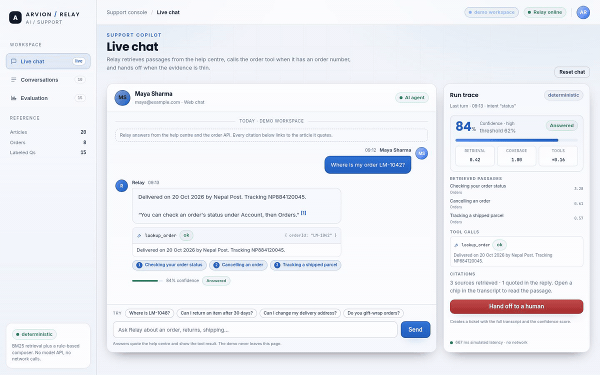
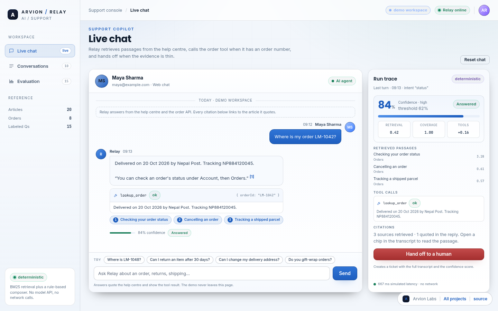
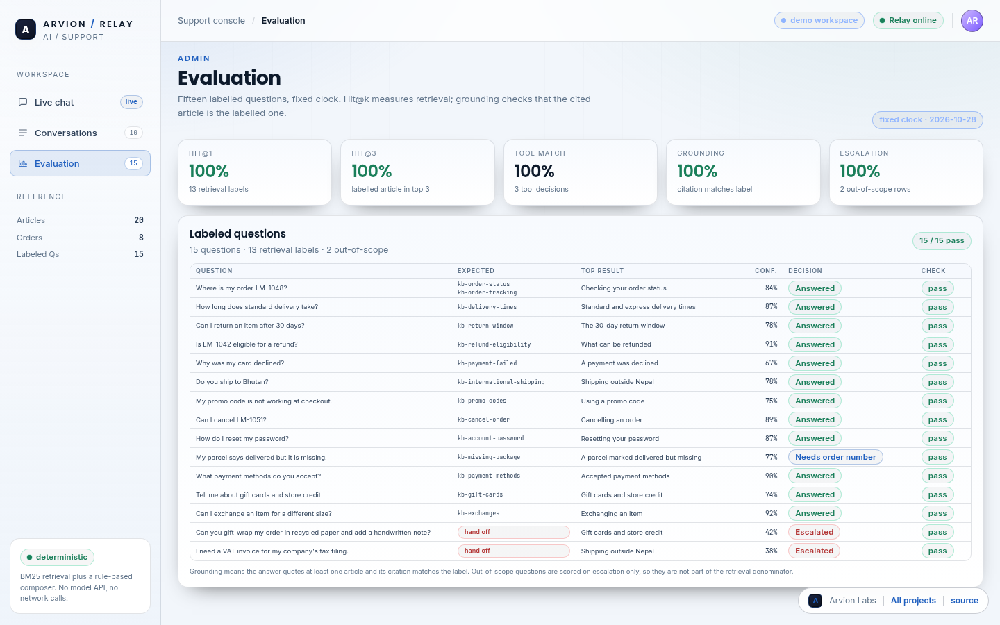

<div align="center">

</div>

<sub>Recorded from the live demo, <a href="docs/demo.mp4">MP4</a> · <a href="docs/screenshot.png">static frame</a></sub>

# Relay

A support copilot that answers from a help centre, shows the passage it quoted,
calls an order tool when it has an order number, and hands the conversation to a
human when the evidence is thin. It runs entirely in one static page: no model
API, no network calls, no build step.

[**Open the live demo**](https://arvion-technology.github.io/labs/demos/relay/demo/) · [MIT](LICENSE)

Relay is the AI/support sample in the Arvion Labs series. The point is not a chat
bubble: it is the trace behind the bubble. Retrieval scores, the exact sentences
that became the answer, the tool arguments and result, the confidence arithmetic
and the escalation decision are all rendered next to the reply. The model is not
an LLM; it is a deterministic composer over BM25 retrieval, and the README says so
before the code does.

## What it does

- **Chat with evidence**: every answer carries citation chips that expand the
  quoted article passage, a tool-call card with arguments and result, and a
  confidence meter.
- **Twenty-article help centre**: orders, shipping, returns, payments, promotions,
  account and support. BM25 retrieval over titles, tags and body text.
- **Tool calls against a mock order API**: `lookup_order` and
  `refund_eligibility` read an eight-row in-memory table with a fixed clock.
- **Confidence with a visible threshold**: retrieval score, query-term coverage,
  tool outcome and citations combine into a score; below 0.62 the agent escalates.
- **Human hand-off that creates a ticket**: ticket id, queue, priority, SLA and the
  full transcript, including the confidence score that triggered the hand-off.
- **Admin: conversations**: the seeded conversation log with deflection rate,
  hand-off count, first-response percentiles, a ticket queue and a confidence mix.
- **Admin: evaluation**: fifteen labelled questions with hit@1, hit@3, MRR, tool
  accuracy, grounding and escalation accuracy, computed on every render.
- **Keyboard and routing**: all three views are deep-linkable (`#chat`,
  `#conversations`, `#evaluation`); the conversation log exports as CSV.

## Screenshots

| Live chat with citations and trace | Evaluation over labelled questions |
| --- | --- |
|  |  |

The second view is the `#evaluation` deep link. It shows every labelled row,
including the two out-of-scope questions that correctly escalate.

## Architecture

```
 demo/
  ├── index.html          shell: sidebar, chat, admin tabs
  ├── app.js              transcript rendering, trace panel, routing
  ├── styles.css          support console styling for theme-azure
  └── arvion.css/js       shared design system and helpers

 src/
  ├── corpus.js           20 help-centre articles (a fictional outdoor store)
  ├── tokenize.js         lowercase, stopwords, light plural stemming
  ├── retrieval.js        BM25 index, search, coverage, hit@k helpers
  ├── tools.js            mock order table, intent rules, tool execution
  ├── composer.js         sentence ranking, quoted passages, citations
  ├── confidence.js       weighted score and the 0.62 hand-off threshold
  ├── agent.js            one turn: retrieve → plan → tools → compose → score
  ├── escalation.js       ticket creation with transcript and queue
  ├── metrics.js          deflection, response percentiles, confidence buckets
  ├── conversations.js    ten seeded conversations built by the real agent
  └── evaluation.js       15 labelled questions and the eval harness

 test/                    51 node:test cases across seven files
```

An article, an order and an answer are plain objects:

```js
{
  id: "kb-refund-eligibility",
  title: "What can be refunded",
  category: "Returns",
  tags: ["refund", "eligible", "final sale", "gift card"],
  body: "A refund is available when the item is within the 30-day return window…"
}

// the shape of one agent turn
{
  text: "Eligible for NPR 5,340 to the original payment method…",
  citations: [{ index: 1, articleId: "kb-refund-eligibility", snippet: "…" }],
  toolCalls: [{ name: "refund_eligibility", args: { orderId: "LM-1042" }, ok: true }],
  confidence: { score: 0.906, decision: "answer", threshold: 0.62 },
  retrieval: [{ articleId: "kb-refund-eligibility", score: 4.81 }]
}
```

The eval tab and the admin log consume those same objects; there is no separate
reporting model to fall out of sync.

## Quickstart

```bash
git clone https://github.com/arvion-technology/relay.git
cd relay
npm test          # 51 tests, no dependencies, Node 20+
npm run demo      # serves the static app on http://localhost:4173
```

There is nothing to install and no key to set. `package.json` exists so the test
runner, CI matrix and screenshot scripts have an entry point.

```bash
npm run shot      # docs/screenshot.png (live chat)
npm run shot:2    # docs/screenshot-2.png (#evaluation deep link)
npm run verify    # unit tests plus the demo asset check
```

Using the agent directly:

```js
import { createAgent, answerQuestion } from "./src/agent.js";

const agent = createAgent();                       // fixed demo clock: 2026-10-28
const answer = answerQuestion(agent, "Is LM-1042 eligible for a refund?");

answer.decision;                                   // "answer"
answer.toolCalls[0].result.eligible;               // true
answer.citations[0].articleId;                     // "kb-refund-eligibility"
```

## How it works

**Retrieval is BM25, deliberately.** Twenty articles do not justify embeddings or a
vector store, and an explainable score is more useful in a support console than a
cosine distance. The index tokenises title, body and tags; the title is included
twice as a cheap field boost. Stopwords are removed and plurals folded with a
small stemmer, not a full Porter implementation. BM25 uses `k1 = 1.4` and
`b = 0.75`; the demo shows the raw score per passage and a saturating `0..1`
normalisation for the confidence model.

**Tool planning is rules because the domain is narrow.** An order number is
matched with `\bLM[-\s]?\d{3,5}\b`. Refund language selects
`refund_eligibility`; status, cancel, address and damage language selects
`lookup_order`. A generic policy question ("can I return an item after 30 days?")
does not trigger a lookup, while a possessive question ("where is my order?")
asks for the missing order number instead of inventing one. A tool result is data,
not prose: the demo can print the exact arguments and the row that answered them.

**The composer quotes rather than generates.** It splits the retrieved article into
sentences, ranks them by how many query terms they contain, and quotes the best one
(occasionally a second, but only when that passage scores at least 55% of the top
one). Tool results are written first, then the quoted passage with `[1]` markers
that map to the citation array. If nothing clears the retrieval floor and no tool
ran, the composer says so and the confidence model escalates.

**Confidence is heuristic and visible.** The score is
`0.52 × retrieval + 0.40 × coverage + 0.06 × citations + tool delta`, where a
successful tool adds `+0.16`, a failed tool subtracts `0.12`, and any successful
lookup floors the score at `0.78` because verified order data should not be
penalised for a short query. Below `0.62` the decision is `escalate`; a missing
order number produces `clarify` instead, so the agent can ask a question without
opening a ticket. The score is not a calibrated probability and the README does not
pretend otherwise.

**Hand-off is a real object.** `escalateConversation` builds a ticket with an id
(`TKT-1001`…), queue, priority, SLA, the last confidence score and a transcript of
every message. The chat renders the ticket inline and the admin log lists it; the
customer never has to repeat the conversation.

**Evaluation is labelled, not sampled.** Fifteen questions carry expected article
ids, an expected tool and an expected escalation decision. Hit@k and MRR use the
thirteen questions that have a retrieval label; out-of-scope questions are scored
only on escalation so they do not pad the retrieval denominator. Grounding means
the answer's citation matches the labelled article and the text contains a citation
marker. Every number in the admin tab is computed from those rows at render time.

## Tests

```bash
npm test
```

51 `node:test` cases across seven files:

- tokenizer behaviour, plural stemming, stopword removal and term frequency
- BM25 ranking for order, refund, delivery, international and account queries,
  score normalisation, coverage, hit@k and reciprocal rank
- order-id extraction, intent detection, planner decisions (including the
  difference between policy questions and questions with a missing order number),
  refund eligibility rules for the window, final sale, returns and undelivered
  orders, typed tool errors
- composer citation serialisation and sentence ranking through the agent answers
- confidence boundaries, the successful-tool floor, failed-tool penalty and the
  missing-order-number penalty
- escalation ticket fields, transcript contents, immutability and double-hand-off
  protection
- metrics percentiles, deflection and escalation rates, confidence buckets
- all fifteen eval rows pass, out-of-scope rows escalate, every row carries a
  finite confidence and a decision
- the ten seeded conversations are deterministic and produce two hand-offs

The demo also has a static asset check (`node scripts/serve-check.mjs`) that runs
in CI with the tests.

## Limitations

- **This is not an LLM.** The answer is assembled from retrieved sentences by term
  overlap. It cannot paraphrase beyond the vocabulary of the twenty articles, so a
  valid question that uses different words ("jacket" instead of "item") can score
  low or escalate. That failure mode is visible in the eval rows rather than hidden.
- **Confidence is a heuristic, not a probability.** The weights and threshold were
  chosen for the demo; they are not calibrated on real support traffic.
- **The evaluation set is small.** The tab prints 100% on these fifteen hand-labelled
  questions. That is a statement about this corpus and this report, not about
  support accuracy in general; a fifteen-row set cannot support that claim.
- **The order API is a table.** Eight rows, fixed clock at 2026-10-28, no database,
  no authentication and no side effects. A real refund action would need an audit
  trail and an idempotency key.
- **Response times are simulated.** Latency shown in the trace and the admin
  percentiles is derived from answer length and tool latency, not measured network
  or model time.
- **Nothing persists and nothing is multi-tenant.** Reloading restores the seed
  conversations; tickets live in memory; there is no user model, routing rule or
  integration with a real helpdesk.

## Project layout

```text
relay/
├── demo/               static console (no build step)
│   ├── index.html      sidebar, chat, conversations and evaluation panels
│   ├── app.js          renderers, transcript state, hash routing
│   ├── styles.css      light azure console styling
│   ├── arvion.css      design tokens, shell, components
│   ├── arvion.js       shared helpers, CSV download and toasts
│   └── fonts/          self-hosted Inter and Poppins
├── src/                eleven framework-free ES modules (the real logic)
├── test/               51 node:test cases
├── scripts/            serve, screenshot, bundle check
├── docs/               screenshots and the recorded demo
└── .github/workflows/  CI: tests on Node 20 and 22
```

## Credits

Built by [Arvion Technologies](https://arviontech.net) in Kathmandu as part of our
open-source [Labs](https://github.com/arvion-technology/labs) series. We build web
platforms, mobile apps and cloud systems for clients; the demos are a fair sample
of how we work.

MIT licensed.
